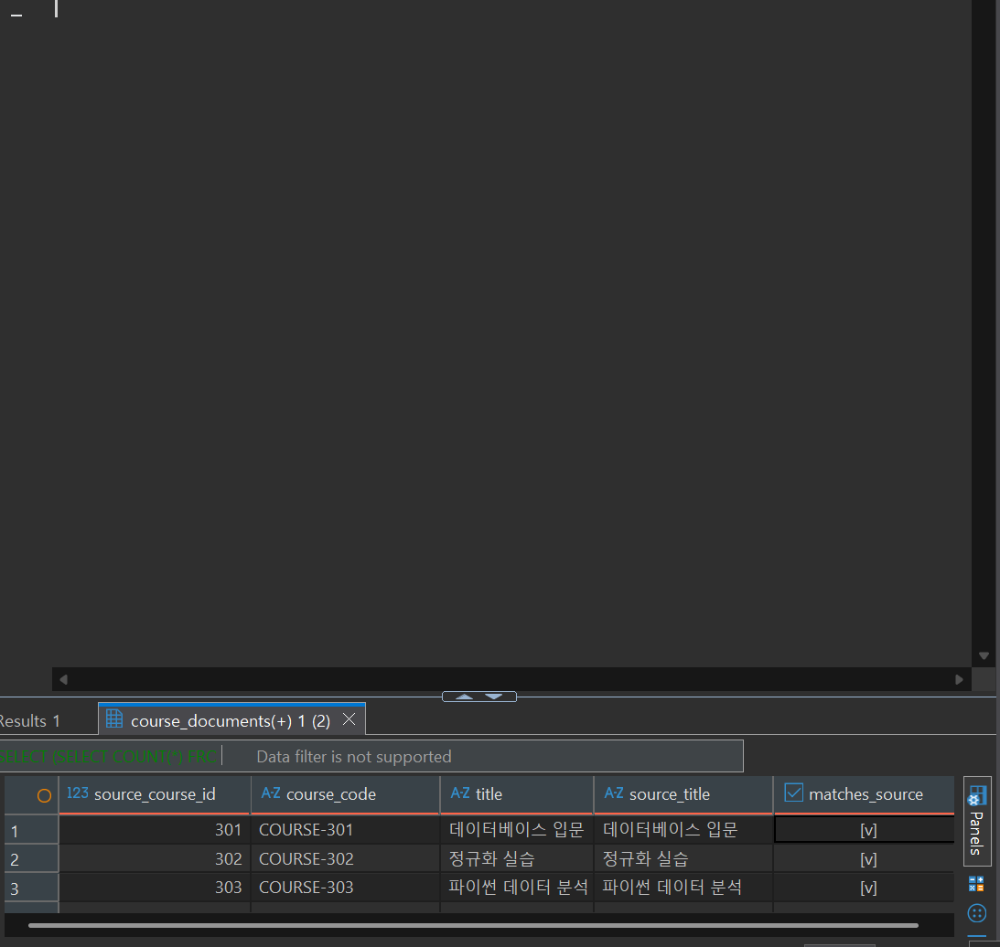
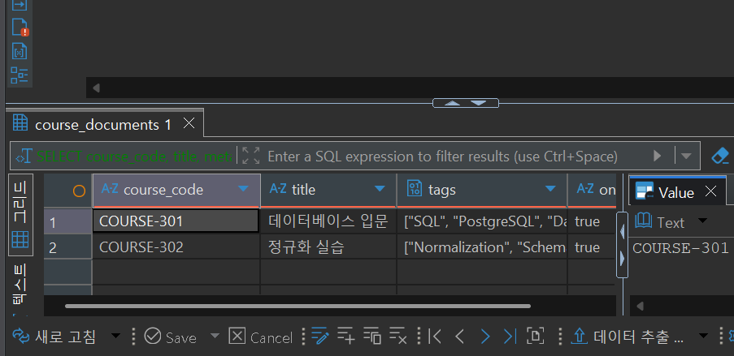

# Chapter 12 확장 실습 답안 템플릿

> **과제:** 조회 패턴으로 RDBMS와 NoSQL 선택하기  
> **사용 방법:** 이 파일을 내려받아 본인의 GitHub 저장소에 `chapter12_answer.md`라는 이름으로 저장한 뒤 실습하면서 바로 작성합니다.  
> **제출 방법:** LMS에는 파일을 직접 업로드하지 않고, **본인 GitHub 저장소의 `chapter12_answer.md` 파일 URL**을 제출합니다.

---

## 제출 전 주의

이 파일과 캡처 화면에는 실제 비밀번호, 전체 DB 접속 URL, API Key, 개인정보를 기록하지 않습니다.

```text
GitHub 계정 또는 별칭:
과제 작성일: 2026-10-06
PostgreSQL 버전:
사용한 AI 도구: Claude Code (Claude Sonnet 5.5)
```

> 이번 장에서는 MongoDB, Redis, Cassandra, Graph DB 같은 별도 서버를 반드시 설치하지 않습니다.  
> 제공된 PostgreSQL `nosql_lab`을 이용해 **원본·파생·캐시·문서·저장소 선택 기준**을 실습합니다.

---

# 1. 시작 환경과 Chapter 07 기준 상태 확인

다음을 실행합니다.

```sql
SELECT current_database();
SELECT current_user;
SELECT current_schema();
SHOW search_path;
```

| 확인 항목 | 실제 결과 | 의미 |
| --- | --- | --- |
| `current_database()` | `ai_database_book` | 실습 대상 DB가 `ai_database_book`인지 확인한다. 다른 DB면 스크립트가 중단된다. |
| `current_user` | `postgres` | 어떤 권한으로 객체를 만드는지 확인한다. 스키마 생성에는 DB의 CREATE 권한이 필요하다. |
| `current_schema()` | `public` | 이름 없이 만든 객체가 어느 스키마에 들어가는지 확인한다. |
| `search_path` |  | 스키마를 생략했을 때 테이블을 찾는 순서다. |

Chapter 07·08 기준 상태도 확인합니다.

```text
students = 3
instructors = 2
courses = 3
enrollments = 5

전체 recorded_amount = 590000
활성 = 3건 / 340000
취소 제외 = 4건 / 440000
```

### 기준 상태를 유지한 채 별도 `nosql_lab`에서 실습하는 이유

```text
course_project는 Source of Truth(원본)이므로 실습 중 값이 바뀌면 안 된다.
nosql_lab을 별도 스키마로 두면 실험(JSONB UPDATE, 캐시 예시 등)이 원본에 영향을 주지 않고,
잘못되어도 nosql_lab만 정리하면 된다.
또한 원본 기준값(590000 등)이 그대로여야 이후 장과 자동 검증이 같은 출발점에서 동작한다.
```

---

# 2. 온라인 강의 데이터의 시스템 역할 분류

다음 데이터를 분류합니다.

| 데이터 | 시스템 역할 | Source of Truth 여부 | 잃어버리면 재구축 가능? | 이유 |
| --- | --- | --- | --- | --- |
| 수강신청 | Source of Truth | O | 불가 | 학생이 신청했다는 사실 자체이며 다른 데이터에서 다시 계산할 수 없다. |
| 신청 당시 금액 | Source of Truth | O | 불가 | 신청 시점의 가격 기록이다. 현재 강의 가격으로 다시 만들면 과거와 달라질 수 있다. |
| 로그인 세션 | Ephemeral State | X | 재로그인으로 대체 | 일정 시간만 필요한 임시 상태다. 잃으면 다시 로그인하면 된다. |
| 인기 강의 TOP 3 | Derived Cache | X | 가능 | 수강신청 원본에서 다시 집계해서 만들 수 있다. |
| 강의 태그/옵션 | Flexible Metadata | 강의 속성의 일부(원본 쪽) | 불가에 가까움 | 강의마다 항목이 달라질 수 있는 부가 속성이라 JSONB 후보다. |
| 학습 행동 이벤트 | Event Log | O(발생한 사실의 기록) | 불가 | 이미 지나간 행동의 기록이라 나중에 재현할 수 없다. 추가만 하고 수정하지 않는다. |
| 추천 관계 | Relationship Index | X | 가능 | 학습 이력·태그 등에서 계산해 만든 관계 인덱스다. |

사용 가능한 역할 예:

```text
Source of Truth
Derived Cache
Ephemeral State
Flexible Metadata
Event Log
Relationship Index
```

### Source of Truth와 파생 저장소를 구분해야 하는 이유

```text
값이 서로 다를 때 어느 쪽을 믿어야 하는지 정하기 위해서이다.
원본과 파생을 구분해 두면 파생(캐시·추천 관계)은 지우고 원본에서 다시 만들면 되지만,
원본을 잃으면 복구할 방법이 없다. 그래서 백업·권한·트랜잭션 같은 엄격한 보호는 원본에 집중하고,
파생 저장소는 재구축 방법만 확보하면 된다.
구분하지 않으면 장애 때 어느 데이터를 기준으로 복구할지 판단할 수 없다.
```

---

# 3. 저장소보다 먼저 조회·쓰기 패턴 정의

최소 6개의 읽기/쓰기 문장을 작성합니다.

| ID | 읽기/쓰기 문장 | 키/조건 | 정렬/범위 | 예상 빈도 | 일관성 요구 | 함께 원자적으로 맞아야 하는 데이터 |
| --- | --- | --- | --- | --- | --- | --- |
| Q01 | 학생 101의 최근 30일 학습 이벤트를 시간순으로 읽는다 | student_id = 101 | 발생 시각 오름차순, 최근 30일 | 높음 | 약간 늦어도 허용 | 없음(이벤트는 추가만 함) |
| Q02 | `course:popular:v1:top3` 키로 인기 강의 3개를 읽는다 | 정확한 키 1개 | 없음(미리 계산된 3건) | 매우 높음 | 몇 분 오래된 값 허용 | 없음 |
| Q03 | 강의 301의 태그와 온라인 제공 옵션을 읽는다 | course_code = COURSE-301 | 단건 | 높음 | 최신 값이 보이면 좋음 | 같은 문서 안의 태그·옵션 |
| Q04 | 학생과 강의의 수강신청을 하나의 트랜잭션으로 확정한다 | student_id, course_id | 단건 쓰기 | 중간 | 강한 일관성 필수 | 신청 행, 신청 당시 금액, 활성 신청 중복 방지 |
| Q05 | 학생 A와 관심 주제가 가까운 강의를 2~3단계 관계로 탐색한다 | 시작 노드 = 학생 A, 깊이 2~3 | 가까운 순 | 낮음~중간 | 약간 오래된 추천 허용 | 없음 |
| Q06 | 강의 문서의 `instructor_snapshot`이 원본 강사 정보와 같은지 대조한다 | source_course_id → course_project.courses → instructors | 3건 전체 | 낮음(배치) | 원본이 기준 | 문서 스냅샷과 원본 강사 정보 |

### 기술 이름보다 조회 패턴을 먼저 작성해야 하는 이유

```text
저장소는 어떤 키와 조건으로 얼마나 자주 읽고 쓰는지에 따라 적합성이 달라지는 도구이기 때문이다.
패턴 없이 "NoSQL이 빠르다더라" 같은 이름만 보고 고르면 필요 없는 저장소를 추가해
동기화·보안·백업 책임만 늘어난다. 패턴을 먼저 쓰면 일관성이 필요한지, 오래된 값을 허용하는지가 드러나
PostgreSQL로 충분한지, 다른 모델의 PoC가 필요한지를 근거로 판단할 수 있다.
```

---

# 4. `nosql_lab` 생성과 기준 데이터 확인

다음 파일을 순서대로 실행합니다.

```text
code/chapter12/01_nosql_lab_schema.sql
code/chapter12/02_nosql_lab_seed.sql
```

## 4-1. 기준 행 수

| 테이블 | 기대 행 수 | 실제 행 수 | 일치? |
| --- | ---: | ---: | --- |
| `nosql_lab.course_documents` | 3 |  |  |
| `nosql_lab.key_value_cache_examples` | 4 |  |  |
| `nosql_lab.storage_choice_cases` | 6 |  |  |

## 4-2. 원본 매핑 확인

| source_course_id | 기대 course_code | 실제 title | 원본과 일치? |
| ---: | --- | --- | --- |
| 301 | `COURSE-301` | 데이터베이스 입문 | 일치 |
| 302 | `COURSE-302` | 정규화 실습 | 일치 |
| 303 | `COURSE-303` | 파이썬 데이터 분석 | 일치 |

문서의 `title`을 `course_project.courses.title`과 JOIN해서 비교한 결과 세 행 모두 `matches_source = true`였다.

### 증거 화면

권장 경로:

```text
assignments/chapter12/images/step04_nosql_lab.png
```



위 화면은 nosql_lab의 강의 문서 3건(COURSE-301~303)이 원본 `course_project.courses`의 제목과 모두 일치함을 보여 준다.

---

# 5. PostgreSQL JSONB 혼합 문서 실습

다음을 실행합니다.

```text
code/chapter12/03_document_jsonb_queries.sql
```

## 5-1. 일반 컬럼과 JSONB 영역 구분

| 항목 | 일반 컬럼 / JSONB | 그렇게 둔 이유 |
| --- | --- | --- |
| `source_course_id` | 일반 컬럼 | 원본 강의와 대조하는 핵심 키라 타입·UNIQUE·NOT NULL 규칙이 필요하다. |
| `course_code` | 일반 컬럼 | 모든 문서에 있고 식별·검색에 쓰는 안정된 값이다. UNIQUE로 보호한다. |
| `title` | 일반 컬럼 | 모든 문서의 필수 값이며 공백 금지 같은 제약을 걸 수 있다. |
| `level` | 일반 컬럼 | 모든 문서에서 반복 검색·검증하며 허용값(basic/intermediate/advanced)이 정해져 있다. |
| `document_version` | 일반 컬럼 | 낙관적 잠금 조건(WHERE version = ?)에 쓰는 핵심 값이라 타입과 1 이상 제약이 필요하다. |
| `tags` | JSONB | 강의마다 개수와 내용이 달라지는 가변 배열이다. |
| `options` | JSONB | 온라인 제공 여부 등 강의마다 달라질 수 있는 옵션이라 스키마 변경 없이 항목을 추가할 수 있다. |
| `instructor_snapshot` | JSONB | 화면 표시용으로 복사해 둔 값으로 구조가 유연해도 된다. 원본은 `course_project.instructors`이다. |

### `level`을 JSONB 안에 넣지 않고 일반 컬럼으로 둔 이유

```text
level은 모든 강의에 반드시 있고, 자주 검색하며, 허용값이 정해진 안정적인 속성이다.
일반 컬럼이면 CHECK로 허용값을 DB가 강제하고, 인덱스와 통계도 단순하게 쓸 수 있다.
JSONB 안에 넣으면 오타나 타입 오류를 DB가 막지 못하고 조회 식도 복잡해진다.
구조와 규칙이 안정적이면 일반 컬럼, 항목마다 달라지는 부가 속성이면 JSONB가 맞다.
```

### `instructor_snapshot`이 Source of Truth가 아닌 이유

```text
강사 정보의 원본은 course_project.instructors이고, snapshot은 화면 표시를 위해 복사해 둔 사본이다.
원본에서 강사 이름이나 전문 분야가 바뀌어도 사본은 자동으로 바뀌지 않아 달라질 수 있다.
둘이 다르면 원본을 신뢰하고 snapshot을 원본에서 다시 만들어야 한다.
```

## 5-2. JSONB 조회 결과

```text
사용한 JSONB 조건: metadata @> '{"options": {"online": true}}'  (포함 연산자)
예상 결과: 온라인 제공 강의인 COURSE-301, COURSE-302 두 건 (COURSE-303은 online = false)
실제 결과: COURSE-301 데이터베이스 입문, COURSE-302 정규화 실습 두 건이 조회되었고 online = true였다.
```

```sql
SELECT course_code, title,
       metadata -> 'tags'               AS tags,
       metadata #>> '{options,online}'  AS online
FROM nosql_lab.course_documents
WHERE metadata @> '{"options": {"online": true}}'
ORDER BY source_course_id;
```



`@>`는 왼쪽 JSONB가 오른쪽 조건을 포함하는지 검사하므로, 일반 컬럼 없이도 중첩된 옵션 값으로 필터링할 수 있다.

## 5-3. 낙관적 잠금 관찰

```text
읽은 document_version: 1
UPDATE 조건에 사용한 version: 1
예상 영향 행 수: 1
실제 영향 행 수:
ROLLBACK 후 COURSE-301의 document_version: 1 (기준 상태 유지)
```

### 영향 행 수가 0이면 무엇을 의심해야 하나요?

```text
1) 다른 작업이 먼저 문서를 수정해 document_version이 이미 올라갔는지(내가 읽은 version이 오래됨),
2) WHERE 조건의 course_code나 version 값이 실제 문서와 맞는지(오타·다른 문서)를 확인한다.
0행은 오류가 아니라 "내가 읽은 뒤 누군가 먼저 바꿨다"는 신호이므로,
다시 읽어서 최신 상태를 확인한 뒤 재시도할지 판단해야 한다.
```

### 실습에서 ROLLBACK 후 기준 상태를 유지하는 이유

```text
최종 자동 검증(07)이 COURSE-301의 document_version = 1을 기준으로 확인한다.
ROLLBACK을 하지 않아 version이 2로 남으면 검증이 실패하고, 이후 실습의 출발점도 달라진다.
변경 결과를 관찰만 하고 되돌려야 누가 언제 실행해도 같은 결과를 얻을 수 있다.
```

---

# 6. Key-Value 캐시 개념 실습

다음을 실행합니다.

```text
code/chapter12/04_key_value_cache_queries.sql
```

## 6-1. Seed 기준

```text
전체 캐시 = 4
Seed 시점 유효 = 3
Seed 시점 만료 = 1
```

| 항목 | 기대 | 실제 |
| --- | ---: | ---: |
| 전체 | 4 |  |
| Seed 시점 유효 | 3 |  |
| Seed 시점 만료 | 1 |  |

## 6-2. Seed 기준과 현재 시각 기준 차이

```text
현재 유효 캐시 수:
```

### 현재 유효 건수를 고정 정답으로 사용하면 안 되는 이유

```text
현재 시각 기준 조건(expired_at > CURRENT_TIMESTAMP)은 시간이 지나면 결과가 달라진다.
오늘은 유효였던 캐시가 내일은 만료되어 같은 SQL이 다른 숫자를 돌려준다.
반면 Seed 시점 기준(expired_at > created_at)은 데이터만으로 정해져서 언제 실행해도 같다.
그래서 재현이 필요한 검증에는 Seed 기준을 쓰고, 현재 유효 건수는 "그 시점의 관찰값"으로만 기록한다.
```

## 6-3. 정확 키 조회

```text
조회한 키:
결과:
캐시 미스 여부:
```

### Key-Value 제품의 TTL과 eviction을 같은 개념으로 보면 안 되는 이유

```text
TTL(expiration)은 값에 정해 둔 시간이 지나면 만료되는 것이고,
eviction은 메모리가 부족할 때 정책(예: 오래 안 쓴 것부터)에 따라 아직 만료되지 않은 값도 지우는 것이다.
TTL을 길게 잡아도 eviction으로 값이 사라질 수 있으므로,
"넣어 두면 TTL 동안은 항상 있다"고 가정하면 캐시 미스를 처리하는 코드가 없어 장애가 난다.
```

### 이 PostgreSQL 테이블이 실제 Redis 같은 Key-Value DB가 아닌 이유

```text
이 테이블은 디스크에 저장되는 PostgreSQL 행이며 키 조회 개념만 흉내 낸 것이다.
메모리 저장, 자동 TTL 삭제(만료 행은 직접 지워야 함), eviction, 복제, 샤딩, 실제 네트워크 성능과
장애 동작은 제공하지 않는다. 그래서 여기서 본 속도나 동작을 실제 Key-Value 제품의 성능 근거로 쓸 수 없다.
```

---

# 7. 캐시 장애 사고 실험

상황:

```text
PostgreSQL 원본에서는 인기 강의 순위가 변경되었다.
캐시에는 이전 TOP 3가 남아 있다.
```

다음에 답합니다.

```text
신뢰해야 할 원본: PostgreSQL의 수강신청 원본 데이터(캐시는 사본일 뿐이다)
사용자에게 오래된 값을 허용할 수 있는 시간: 인기 순위는 몇 분(예: 5분) 정도 오래돼도 업무상 문제가 적다.
                                        수강신청 가능 여부·금액처럼 정확해야 하는 값은 캐시에서 읽지 않는다.
캐시 갱신 방식: 주기적 재계산 또는 원본 변경 시 해당 키 삭제(무효화)를 택할 수 있다.
              삭제는 단순하고 실수해도 다음 조회에서 원본으로 다시 만들어지지만, 직후 첫 요청이 느려진다.
캐시 삭제 후 재생성 방법: 캐시 미스가 나면 원본에서 TOP 3를 집계해 같은 키에 TTL과 함께 다시 저장한다.
캐시 서버 장애 시 fallback: 캐시를 읽지 못하면 PostgreSQL 원본을 직접 조회한다(느려도 서비스는 유지).
동시 재생성 요청이 몰릴 때의 위험: 키가 삭제되는 순간 많은 요청이 동시에 미스가 나 원본 DB에 같은 집계 쿼리가 몰린다.
                                   재생성을 한 요청만 하도록 잠그거나, 만료 시각에 약간의 무작위 차이를 둬서 완화한다.
```

### 캐시가 Source of Truth가 되어서는 안 되는 이유

```text
캐시는 원본에서 다시 만들 수 있는 파생 데이터이므로 언제든 만료·삭제·유실될 수 있다.
캐시에만 있는 값이 있다면 장애나 eviction 한 번에 영구히 사라진다.
또 원본과 값이 다를 때 어느 쪽이 맞는지 판단할 기준이 없어진다.
```

---

# 8. 저장 방식 선택 사례 검토

다음을 실행합니다.

```text
code/chapter12/05_storage_choice_review.sql
```

각 사례에서 최소 다음 정보를 확인합니다.

| 사례 | system_role | primary_query | 후보 저장소 | consistency | sync 전략 | recovery 전략 | decision_status |
| --- | --- | --- | --- | --- | --- | --- | --- |
| 1 |  |  |  |  |  |  |  |
| 2 |  |  |  |  |  |  |  |
| 3 |  |  |  |  |  |  |  |
| 4 |  |  |  |  |  |  |  |
| 5 |  |  |  |  |  |  |  |
| 6 |  |  |  |  |  |  |  |

결정 상태:

```text
candidate
poc_planned
hold
adopted
rejected
```

### 후보 저장소와 실제 채택을 구분해야 하는 이유

```text
후보는 "검토해 볼 만하다"는 뜻일 뿐, 실제로 요구사항을 만족하는지는 PoC로 확인해야 알 수 있다.
후보를 곧바로 채택으로 취급하면 검증 없이 저장소가 늘어나 동기화·보안·백업·복구 책임이 따라온다.
상태를 candidate → poc_planned → adopted/rejected로 나눠 기록하면 왜 도입했는지, 왜 보류했는지가 남는다.
```

### 현재 데이터에서 `adopted`가 PostgreSQL 원본 1건뿐인 이유를 자신의 말로 설명

```text
현재 요구사항에서 반드시 보존해야 하고 트랜잭션이 필요한 원본은 PostgreSQL에 있고, 이미 검증되어 쓰고 있다.
나머지(캐시·이벤트 로그·관계 탐색 등)는 규모와 조회 패턴이 PostgreSQL로도 처리 가능한 수준이고,
다른 저장소를 쓰려면 성공 기준을 가진 PoC가 먼저 필요하다. 그래서 아직은 candidate, poc_planned, hold로 두었다.
```

---

# 9. 저장 모델 비교표

제품 이름보다 저장 모델을 비교합니다.

| 후보 | 잘 맞는 접근 패턴 | 트랜잭션/일관성 고려 | 재구축 가능성 | 운영·보안·백업 부담 | 현재 판단 |
| --- | --- | --- | --- | --- | --- |
| PostgreSQL RDBMS | 관계가 있는 원본, JOIN·집계, 여러 행을 함께 맞춰야 하는 쓰기 | 강한 일관성, ACID 트랜잭션, 제약조건 | 원본이라 재구축 대상이 아니라 백업 대상 | 이미 운영 중이라 추가 부담 없음 | 채택(원본) |
| PostgreSQL JSONB | 강의 태그·옵션처럼 항목이 달라지는 부가 속성 | 같은 DB 안이라 트랜잭션·제약 그대로 사용 | 원본의 일부라 백업 대상 | 추가 저장소 없음, 인덱스 설계는 필요 | 부가 속성에 한해 사용 |
| Key-Value | 키로 단건을 빠르게 읽는 캐시·세션 | 보통 단건 단위, 원본과의 불일치 허용 필요 | 파생이면 원본에서 재생성 | 동기화·TTL 정책·접근 권한·장애 대응 추가 | 후보/PoC |
| Document | 중첩 구조 문서를 통째로 읽고 쓰는 경우 | 제품별 보장이 다름, 문서 간 트랜잭션은 확인 필요 | 원본이면 백업 필수 | 새 서버 운영·백업·보안 필요 | 보류 |
| Column-Family | 대량 이벤트를 파티션 키와 시간으로 읽는 경우 | 최종 일관성 모델이 흔하므로 요구사항 확인 필요 | 이벤트 원본이면 재구축 불가 | 파티션 설계와 운영 복잡도 큼 | 보류 |
| Graph | 2~3단계 이상 관계 탐색(추천 등) | 관계 데이터 정합성 책임 필요 | 원본 관계에서 재계산 가능 | 새 서버·쿼리 언어·동기화 필요 | 보류 |

### “NoSQL은 항상 더 빠르다”가 잘못된 설명인 이유

```text
빠르고 느린 것은 저장소 종류가 아니라 접근 패턴과 데이터 규모에 달려 있다.
키로 단건을 읽는 경우는 Key-Value가 유리할 수 있지만, JOIN·집계·범위 조회·강한 일관성이 필요한 경우는
PostgreSQL이 더 단순하고 빠를 수 있다. 데이터가 작으면 어느 쪽이든 차이가 거의 없다.
제품별 보장과 성능은 공식 문서와 PoC로 확인해야 한다.
```

### 저장소가 하나 추가될 때 새로 생기는 운영 책임 최소 5개

```text
1. 원본과의 동기화(변경 전달, 지연·누락 처리)
2. 재시도와 멱등성(같은 메시지를 두 번 처리해도 중복이 생기지 않게)
3. 접근 권한과 비밀 관리(새 계정·접속 정보)
4. 백업과 복원(그리고 복원 시험)
5. 모니터링·장애 대응·버전 업그레이드·비용
```

---

# 10. JSONB 인덱스 후보 관찰

다음을 실행합니다.

```text
code/chapter12/06_jsonb_index_candidates.sql
```

본문 후보:

```text
metadata @> ...
→ GIN 후보

metadata #>> '{options,online}' = 'true'
→ 표현식 B-tree 후보
```

## 10-1. 생성된 인덱스

| 인덱스 | 대상 표현식/컬럼 | 대응 조회 | 실제 정의 확인 |
| --- | --- | --- | --- |
|  |  |  |  |
|  |  |  |  |

### 데이터가 3행뿐이라 인덱스가 있어도 Seq Scan이 합리적일 수 있는 이유

```text
3행은 테이블 전체가 한 페이지 안에 들어가므로 전체를 읽는 비용이 인덱스를 거쳐 다시 테이블을 읽는 비용보다 작다.
플래너는 비용을 비교해서 Seq Scan을 고르는 것이 맞다.
인덱스가 존재한다고 해서 항상 Index Scan이 쓰이는 것은 아니다.
```

### `jsonb_ops`와 `jsonb_path_ops`를 무조건 같은 것으로 보면 안 되는 이유

```text
둘 다 GIN 연산자 클래스지만 지원하는 연산이 다르다.
jsonb_ops(기본)는 포함(@>) 외에 키 존재 검사(?, ?|, ?&)도 지원하고 인덱스가 더 크다.
jsonb_path_ops는 포함(@>)과 경로 검색 위주로 지원하고 대신 인덱스가 작고 포함 검색이 빠른 편이다.
쓰는 연산자에 맞게 골라야 하고, 키 존재 검사를 쓰는데 jsonb_path_ops를 만들면 인덱스를 쓰지 못한다.
```

---

# 11. 최종 자동 검증

다음을 실행합니다.

```text
code/chapter12/07_nosql_lab_validation.sql
```

기대 메시지:

```text
Chapter 12 nosql_lab validation passed
```

```text
실제 검증 메시지:
Chapter 12 nosql lab schema validation passed
Chapter 12 nosql lab seed validation passed
Chapter 12 optimistic document update passed inside transaction
Chapter 12 document JSONB practice passed
Chapter 12 JSONB index candidate validation passed
Chapter 12 nosql_lab validation passed
```

> 07 최초 실행에서 `constraints=25, not_null=26` 검사가 `actual=51/26`으로 실패했다. 원인은 PostgreSQL 18이 NOT NULL 제약도 `pg_constraint`(`contype = 'n'`)에 등록해서 PK·UNIQUE·CHECK 25개에 NOT NULL 26개가 더해져 센 것이다(25 + 26 = 51). 구조가 잘못된 것이 아니었고, 07의 제약조건 집계에 `AND contype <> 'n'`을 추가해 해결했다.

검증되는 주요 내용:

```text
Chapter 07 기준 상태 유지
nosql_lab = 3 / 4 / 6
강의 301~303 원본 매핑
instructor_snapshot 원본 대조
JSONB 구조와 document_version 기준 유지
Seed 캐시 = 4 / 3 / 1
저장소 선택 근거 공백 0
adopted 사례 1
JSONB 인덱스 정의
```

### 자동 검증이 통과해도 저장소 선택이 자동으로 정답이 되는 것은 아닌 이유

```text
자동 검증은 행 수·매핑·제약 같은 "데이터와 구조가 기준과 맞는지"만 확인한다.
어떤 저장소가 내 서비스의 조회 패턴, 일관성 요구, 운영 능력에 맞는지는 검증하지 않는다.
그것은 요구사항을 근거로 판단하고 PoC로 확인해야 하는 설계 결정이다.
```

### 증거 화면

권장 경로:

```text
assignments/chapter12/images/step11_validation.png
```

`여기에 최종 검증 통과 화면을 삽입하세요.`

---

# 12. 개인 프로젝트의 데이터 역할 분류

Chapter 07부터 발전시킨 개인 프로젝트를 사용합니다. (프로젝트: 나의 지출내역 관리 — 단일 사용자 가계부)

최소 6개 데이터 항목을 분류합니다.

| 데이터 | 시스템 역할 | Source of Truth? | 대표 조회/쓰기 | 트랜잭션 필요? | 재구축 가능? | 저장소 후보 |
| --- | --- | --- | --- | --- | --- | --- |
| 지출 내역(expenses) | Source of Truth | O | 지출 1건 기록, 기간별 조회 | 필요(금액·카테고리·결제수단 참조가 함께 맞아야 함) | 불가 | PostgreSQL |
| 카테고리·결제수단 | Source of Truth | O | 목록 조회, 이름 추가 | 단건이라 간단 | 불가 | PostgreSQL |
| 카테고리별 월 예산(budgets) | Source of Truth | O | (카테고리, 월)별 조회·수정 | 필요(카테고리·월당 1건 UNIQUE) | 불가 | PostgreSQL |
| 월별 카테고리 지출 합계(예산 대비) | Derived Cache | X | 이번 달 카테고리별 SUM 조회 | 불필요 | 가능(expenses에서 재계산) | PostgreSQL 조회 유지, 부하가 커지면 Key-Value PoC |
| 지출 메모의 태그·영수증 부가 정보 | Flexible Metadata | 지출 내역의 일부 | 지출 1건의 태그 읽기 | 지출과 함께 | 불가 | 현재는 도입 안 함, 필요하면 PostgreSQL JSONB |
| 화면 필터 상태(선택한 월·카테고리) | Ephemeral State | X | 화면에서 조건 선택 | 불필요 | 가능(다시 선택) | 별도 저장소 불필요(앱 메모리) |

---

# 13. 개인 프로젝트 저장 전략 결정

## 13-1. Source of Truth

```text
내 프로젝트의 Source of Truth: PostgreSQL의 expenses, categories, payment_methods, budgets 테이블
그 이유: 지출 기록과 예산은 잃으면 다시 만들 수 없고, 금액·카테고리·결제수단이 함께 맞아야 하며
        FK와 CHECK 같은 제약으로 지켜야 하는 데이터이기 때문이다.
```

## 13-2. PostgreSQL만 유지할지, 다른 저장 모델을 검토할지

```text
현재 결정:
PostgreSQL만 사용
```

### 결정 근거

```text
주요 조회 패턴: 기간별 지출 목록, 카테고리별 월 합계와 예산 비교(JOIN + SUM). 관계형 질의에 잘 맞는다.
일관성 요구: 지출 기록과 예산은 정확해야 하며 오래된 값을 허용하지 않는다.
파생 데이터 여부: 월별 합계는 파생이지만 expenses에서 언제든 다시 계산할 수 있다.
재구축 가능 여부: 파생은 가능, 원본은 백업으로 보호해야 한다.
운영 부담: 저장소를 하나 더 두면 동기화·접근 권한·백업 책임이 늘지만, 단일 사용자 앱에는 얻는 이점이 없다.
백업/복구 부담: PostgreSQL 한 곳만 백업하고 복원 시험하면 된다.
현재 팀 역량: 혼자 운영하며 PostgreSQL 위주로 학습해 왔다.
```

> **“현재는 PostgreSQL만 사용한다”도 충분히 좋은 결론입니다.**  
> 기술을 추가하지 않는 이유를 조회 패턴·일관성·운영 책임으로 설명할 수 있어야 합니다.

---

# 14. 작은 PoC 설계

후보 저장 방식 하나를 골라 실제 도입 전에 확인할 PoC를 설계합니다. (현재 도입 계획은 없고, 지출 데이터가 매우 커지는 경우를 가정한 설계)

```text
후보 저장 방식: Key-Value 캐시
시스템 역할: Derived Cache (월별 카테고리 지출 합계 + 예산 대비 결과)
Source of Truth 여부: 아니오 (원본은 PostgreSQL expenses, budgets)
키/문서/파티션/관계 구조: 키 = budget:summary:v1:{year_month}:{category_id}, 값 = {spent, limit, ratio} JSON, TTL 있음
대표 읽기 2개: (1) 이번 달 특정 카테고리의 지출 합계와 예산 비교 조회
               (2) 이번 달 전체 카테고리 요약 조회
대표 쓰기 1개: 지출 1건이 기록되면 해당 (월, 카테고리) 키를 삭제하거나 갱신한다
원본 동기화 방법: 원본 트랜잭션이 커밋된 뒤 해당 키만 무효화(삭제). 다음 조회 시 PostgreSQL에서 다시 집계해 저장한다
중복/재시도 시 멱등성 처리: 키 삭제와 재집계는 여러 번 해도 결과가 같다. 증가분을 더하는 방식은 쓰지 않는다
장애 시 fallback: 캐시를 읽지 못하면 PostgreSQL에서 직접 집계 조회한다
재구축 방법: 캐시 전체를 지우고 expenses·budgets에서 필요한 키만 조회 시점에 다시 만든다
보안 요구: 캐시 서버는 내부망에서만 접근하고, 접속 정보는 저장소에 올리지 않고 환경변수로 관리한다
백업/복구 방법: 캐시는 백업하지 않는다. 원본 PostgreSQL 백업과 복원 시험으로 충분하다
```

## PoC 성공 기준

최소 5개를 작성합니다.

```text
1. 캐시 미스 시 PostgreSQL 원본에서 합계를 다시 계산해 캐시에 저장한다.
2. 지출을 추가·수정·삭제하면 정해진 시간(예: 1초) 안에 해당 키가 무효화되어 이전 합계가 보이지 않는다.
3. 캐시 서버를 중지해도 지출 조회·기록 기능이 중단되지 않고 원본에서 직접 조회된다.
4. 같은 무효화 요청을 두 번 처리해도 합계가 틀어지지 않는다.
5. 캐시 전체를 삭제한 뒤에도 원본에서 다시 구축해 삭제 전과 같은 값을 얻는다.
```

---

# 15. AI를 저장소 선택 리뷰어로 활용

## 15-1. 내가 AI에게 제공한 정보

```text
Source of Truth:
반복 조회/쓰기 패턴:
트랜잭션 범위:
허용 가능한 불일치:
재구축 가능 여부:
운영·보안·백업 조건:
```

## 15-2. AI 제안 검토

| AI 제안 | 수용 / 수정 / 보류 / 거절 | 근거 |
| --- | --- | --- |
|  |  |  |
|  |  |  |
|  |  |  |
|  |  |  |

### AI가 기술 이름만 보고 추천한 부분이 있었나요?

```text

```

### AI가 놓친 동기화·복구·운영 비용이 있었나요?

```text

```

### AI 제안보다 내가 최종적으로 다르게 판단한 부분

```text

```

---

# 16. 이번 Chapter에서 알게 된 점

다음 문장을 자신의 말로 완성합니다.

```text
1. Source of Truth란 잃어버리면 다른 데이터에서 다시 만들 수 없어서, 값이 다를 때 기준으로 믿어야 하는 원본 데이터 이다.

2. 파생 저장소를 추가할 때 반드시 생각해야 할 것은 원본과의 동기화 방법, 오래된 값의 허용 시간, 장애 시 원본으로의 fallback과 재구축 방법 이다.

3. NoSQL을 선택해야 하는 가장 좋은 이유는 “최신 기술”이 아니라 PostgreSQL로는 감당하기 어려운 구체적인 조회 패턴과 규모가 있고, PoC로 그 이점이 확인되었기 때문 이다.

4. 현재 내 프로젝트에서 가장 적절한 저장 전략은 지출·예산 원본을 PostgreSQL 하나로 유지하고, 월별 합계는 필요할 때 원본에서 집계하는 것 이다.
```

---

# 17. 핵심 증거 화면

권장 3~4장만 사용합니다.

```text
assignments/chapter12/images/step04_nosql_lab.png
assignments/chapter12/images/step05_jsonb.png
assignments/chapter12/images/step06_cache.png
assignments/chapter12/images/step11_validation.png
```

화면 캡처만 제출하지 않습니다. 반드시 각 결과의 의미를 Markdown에 설명합니다.

---

# 18. GitHub 제출 확인

```bash
git status
git add assignments/chapter12
git commit -m "docs: complete chapter12 assignment"
git push
```

GitHub 웹에서 다음을 확인합니다.

```text
chapter12_answer.md가 정상 표시된다.
이미지가 정상 표시된다.
실제 비밀번호·접속 URL·API Key가 없다.
SQL과 결과 해석이 함께 있다.
개인 프로젝트 저장 전략이 작성되어 있다.
AI 제안에 대한 내 판단이 작성되어 있다.
```

---

# 19. LMS 제출 URL

LMS에는 다음 형태의 **본인 파일 URL 하나**를 제출합니다.

```text
https://github.com/<본인-GitHub-ID>/<본인-저장소>/blob/main/assignments/chapter12/chapter12_answer.md
```

다음을 제출하면 안 됩니다.

```text
교수자 답안 템플릿 URL
본인 저장소 메인 URL
로컬 PC 파일 경로
Raw 파일 주소만 제출
```

---

# 최종 자기 점검

- [ ] PostgreSQL 연결과 Chapter 07 기준 상태를 확인했다.
- [ ] 원본·파생·캐시·이벤트·관계 인덱스를 구분했다.
- [ ] 조회/쓰기 패턴을 최소 6개 작성했다.
- [ ] `nosql_lab` 3/4/6 기준을 확인했다.
- [ ] 일반 컬럼과 JSONB의 역할 차이를 설명했다.
- [ ] 낙관적 잠금의 영향 행 수를 해석했다.
- [ ] Seed 캐시 4/3/1과 현재 시각 기준을 구분했다.
- [ ] 캐시 장애 시 Source of Truth와 복구 흐름을 설명했다.
- [ ] 후보 저장소와 실제 채택을 구분했다.
- [ ] JSONB 인덱스 후보를 조회 패턴과 연결했다.
- [ ] `07_nosql_lab_validation.sql`을 통과했다.
- [ ] 개인 프로젝트의 Source of Truth를 정했다.
- [ ] NoSQL이 필요 없다면 그 이유도 설명했다.
- [ ] PoC 성공 기준을 작성했다.
- [ ] AI 제안을 수용/수정/보류/거절로 판단했다.
- [ ] 핵심 캡처를 3~4장 이내로 정리했다.
- [ ] GitHub 웹에서 Markdown과 이미지를 최종 확인했다.
- [ ] LMS에는 본인 `chapter12_answer.md` URL을 제출한다.
