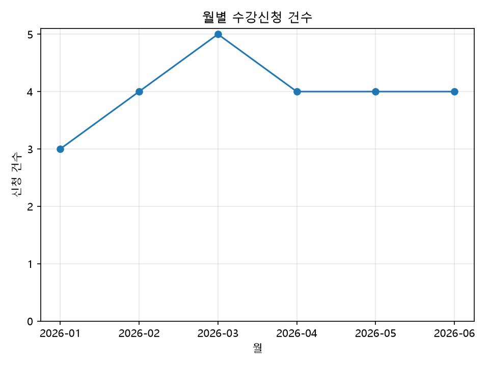

# Chapter 14 확장 실습 답안

> **과제:** SQL 데이터 분석과 Python 확장  
> **제출 방법:** LMS에는 파일을 직접 업로드하지 않고, **본인 GitHub 저장소의 `chapter14_answer.md` 파일 URL**을 제출합니다.

---

## 제출 전 주의

이 파일과 캡처 화면에는 실제 비밀번호, 전체 DB 접속 URL, API Key, password file 내용, 실제 개인정보를 기록하지 않았습니다. (DB 접속 정보는 저장소 밖 `.env`/환경 변수로만 사용, `.env`는 `.gitignore` 대상)

```text
GitHub 계정 또는 별칭: tladntjq1-lgtm
과제 작성일: 2026-10-21
PostgreSQL 버전: 18.4
Python 버전: 3.12.10 (Chapter 14 전용 .venv)
사용한 AI 도구: Claude Code (Claude Opus 5.5)
데이터 읽기 방식: PostgreSQL 직접 연결(A) — CSV + manifest(B)도 추가로 검증
```

> **핵심 원칙**  
> 그래프가 만들어졌다고 분석이 검증된 것은 아닙니다.  
> **질문 → 기간 → 한 행의 의미 → 지표 정의 → SQL 기준값 → pandas 결과 → 교차 검증**이 모두 일치해야 합니다.

---

# 1. 시작 환경 확인

```sql
SELECT version();
SELECT current_database();
SELECT current_user;
SELECT current_schema();
SHOW search_path;
SHOW transaction_read_only;
```

| 확인 항목 | 실제 결과 | 의미 |
| --- | --- | --- |
| PostgreSQL 버전 | PostgreSQL 18.4 on x86_64-windows | 실습 서버 버전. PG18은 NOT NULL도 `pg_constraint`에 기록함(8절 참고) |
| `current_database()` | `ai_database_book` | 교재 실습 DB에 연결되어 있음 |
| `current_user` | `postgres` | 로컬 개발용 관리자 계정으로 SQL 실습 수행 |
| `current_schema()` | `public` | 이름 없는 객체는 public에서 찾음 → 스크립트는 `analysis_lab.` 을 명시 |
| `search_path` | `"$user", public` | 기본 검색 경로. analysis_lab은 경로에 없으므로 스키마를 직접 붙여야 함 |
| `transaction_read_only` | `off` (SQL 세션) / `on` (Python 분석 연결) | SQL 실습 세션은 Seed·VIEW 생성이 가능, Python 연결은 읽기 전용으로 강제 |

```text
Python 버전: Python 3.12.10
```

### 분석용 Python 연결을 읽기 전용으로 사용하는 이유

```text
분석 코드는 데이터를 "읽기만" 해야 한다. 실수로 UPDATE/DELETE가 섞이거나
AI가 만든 코드가 데이터를 바꾸면 SQL 기준값과 pandas 결과를 비교하는 의미가 사라진다.
default_transaction_read_only=on 으로 연결하면 쓰기 시도 자체를 DB가 거부하므로
"분석이 원본을 바꾸지 않았다"는 것을 코드 리뷰가 아니라 DB가 보장해 준다.
```

---

# 2. 분석 질문 계약 작성

```text
P14-Q01 상태별 수강신청 건수
P14-Q02 월별 신청 건수와 신청 시점 기록 금액
P14-Q03 강의별 신청 건수
P14-Q04 지역별 학생 수와 신청 건수
P14-Q05 완료된 신청의 완료 기간
```

## 질문 A

```text
질문 ID: P14-Q02
업무 질문: 2026년 상반기에 매월 수강신청이 몇 건 들어왔고, 신청 시점에 기록된 금액 합계는 얼마인가?
분석 기간: [2026-01-01, 2026-07-01)
날짜 기준: enrollments.enrolled_at (신청일) — 완료일·결제일이 아님
한 행의 의미: 결과 1행 = 1개월 (date spine으로 1~6월 6행 고정)
포함 상태: 신청, 수강중, 완료, 취소 (모든 상태)
제외 상태: 없음 — "신청이 들어온 건수"를 세는 질문이므로 취소도 신청은 발생한 것
지표 이름: enrollment_count, recorded_amount_sum
지표의 업무 의미: 월별 신청 발생 건수 / 신청 시점에 행에 기록된 금액의 합(매출 아님)
예상 검산 방법: 6개월 건수 합 = 24, 금액 합 = 3,210,000 인지 다시 더해 보기 + pandas groupby 결과와 비교
```

## 질문 B

```text
질문 ID: P14-Q05
업무 질문: 완료된 수강신청은 신청부터 완료까지 며칠이 걸렸는가?
분석 기간: [2026-01-01, 2026-07-01) — 신청일 기준
날짜 기준: completed_at - enrolled_at (일 단위)
한 행의 의미: 입력 1행 = 완료된 수강신청 1건, 결과 1행 = 전체 요약(건수·평균·최소·최대)
포함 상태: 완료
제외 상태: 신청, 수강중, 취소 (completed_at 이 없으므로 완료 기간을 정의할 수 없음)
지표 이름: completed_count, avg/min/max_completion_days
지표의 업무 의미: "완료까지 간 신청"이 걸린 기간. 전체 신청자의 학습 기간이 아님
예상 검산 방법: 완료 건수 12 = 상태별 '완료' 건수와 같은지 확인, pandas describe()의 count/mean/min/max와 비교
```

Chapter 14 기준 분석 기간:

```text
[2026-01-01, 2026-07-01)
```

### 반개방 구간 `[start, end)`을 사용하는 이유

```text
BETWEEN '2026-01-01' AND '2026-06-30' 처럼 닫힌 구간을 쓰면 timestamp일 때
6월 30일 00:00 이후 값이 빠지고, 다음 기간과 붙일 때 경계일이 두 번 들어갈 수 있다.
>= 시작일 AND < 다음 기간 시작일 로 쓰면 날짜든 시간이든 경계가 항상 명확하고
기간끼리 이어 붙여도 겹치거나 빠지는 행이 없다.
```

### `recorded_amount`의 정확한 업무 의미

```text
수강신청이 생성된 순간 그 신청 행에 기록해 둔 금액(그 시점의 강의 가격을 복사한 역사값).
이후 강의 가격이 바뀌거나 상태가 취소로 바뀌어도 이 값은 덮어쓰지 않는다.
```

### 왜 `recorded_amount`를 실제 결제 매출 또는 회계 매출이라고 부르면 안 되나요?

```text
이 스키마에는 결제 승인·환불·정산 테이블이 없다. recorded_amount에는 취소된 신청(3건, 440,000)과
아직 결제 여부를 알 수 없는 '신청' 상태도 포함되어 있다.
따라서 이 합계를 매출이라고 부르면 실제로 받지 않은 돈까지 매출로 보고하는 셈이 된다.
```

---

# 3. `analysis_lab` 생성과 Seed 기준 확인

```text
code/chapter14/01_analysis_lab_schema.sql
code/chapter14/02_analysis_lab_seed.sql
```

> `analysis_lab`은 이전 실습에서 이미 생성·Seed되어 있었습니다. 다시 만들지 않고 현재 상태가 기준과 같은지 확인한 뒤 진행했습니다. (08 최종 게이트가 구조·Seed 기준을 다시 검증하며 통과함)

| 객체 | 기대값 | 실제값 | 일치? |
| --- | ---: | ---: | --- |
| `students` | 8 | 8 | ✅ |
| `instructors` | 3 | 3 | ✅ |
| `courses` | 5 | 5 | ✅ |
| `enrollments` | 24 | 24 | ✅ |

```text
students 다음 값: 109
instructors 다음 값: 204
courses 다음 값: 306
enrollments 다음 값: 1025
```

(시퀀스 `last_value` = 109/204/306/1025, `is_called = false` → 다음 INSERT가 받을 값이 정확히 그 값)

### `analysis_lab`을 기존 `course_project`와 분리한 이유

```text
course_project는 Chapter 07에서 요구사항·제약조건을 검증한 운영 데이터 역할이다.
분석 실습은 Seed를 다시 넣거나 VIEW를 만들고 지우는 일이 많으므로 같은 스키마에서 하면
앞 장의 검증 기준이 깨질 수 있다. 별도 스키마에 합성 데이터를 두면 앞 장을 건드리지 않고
분석만 반복할 수 있고, 문제가 생기면 analysis_lab만 초기화하면 된다.
```

### 증거 화면


---

# 4. 집계 전에 데이터 품질 검사

```text
code/chapter14/03_data_quality_checks.sql
```

| 품질 검사 | 예상 | 실제 | 통과? |
| --- | ---: | ---: | --- |
| PK 또는 분석 VIEW 중복 | 0 | 0 | ✅ |
| 고아 학생 FK | 0 | 0 | ✅ |
| 고아 강의 FK | 0 | 0 | ✅ |
| 고아 강사 FK | 0 | 0 | ✅ |
| 완료인데 `completed_at` 없음 | 0 | 0 | ✅ |
| 미완료인데 `completed_at` 존재 | 0 | 0 | ✅ |
| 완료일 < 신청일 | 0 | 0 | ✅ |
| 신청일 < 학생 가입일 | 0 | 0 | ✅ |
| 신청일 < 강의 개설일 | 0 | 0 | ✅ |
| 음수 `recorded_amount` | 0 | 0 | ✅ |
| 취소 후 기록 금액이 0으로 덮인 행 | 0 | 0 | ✅ |
| 분석 기간 밖 기준 데이터 | 0 | 0 | ✅ |
| 활성 신청 중복 | 0 | 0 | ✅ |

품질 요약 행: `enrollment_count 24 / distinct 24 / completed_at NULL 12 / completed 12 / recorded_amount_sum 3210000`

### 품질 검사를 집계보다 먼저 해야 하는 이유

```text
집계는 이상한 행도 그대로 더해 버린다. 중복 행이 있으면 건수가 늘고, 완료일이 없는 '완료'가 있으면
평균 완료 기간에서 조용히 빠진다. 먼저 이상 건수를 0으로 확인해야 이후 숫자를 믿을 수 있다.
```

### SQL이 정상 실행돼도 원본 품질이 잘못되면 분석 결과를 신뢰할 수 없는 이유

```text
SQL은 "쓴 대로" 정확하게 계산할 뿐, 원본이 맞는지는 판단하지 않는다.
잘못된 원본 → 정확한 SQL → 정확하게 잘못된 집계가 나온다. 오류 없이 실행됐다는 것은
문법이 맞다는 뜻이지 결과가 맞다는 뜻이 아니다.
```

---

# 5. SQL 기준 결과 만들기

```text
code/chapter14/04_summary_analysis.sql
code/chapter14/05_period_category_analysis.sql
```

## 5-1. 전체 기준

```text
실제 신청 행 수: 24
실제 recorded_amount 합계: 3,210,000
일치 여부: 일치
```

## 5-2. 상태별 기준

| 상태 | 기대 건수 | 실제 건수 | 일치? |
| --- | ---: | ---: | --- |
| 신청 | 4 | 4 (16.67%) | ✅ |
| 수강중 | 5 | 5 (20.83%) | ✅ |
| 완료 | 12 | 12 (50.00%) | ✅ |
| 취소 | 3 | 3 (12.50%) | ✅ |
| **합계** | **24** | **24** | ✅ |

### 상태별 그룹 합을 전체 24건과 다시 비교해야 하는 이유

```text
WHERE 조건이나 JOIN 때문에 일부 행이 빠지거나(NULL 상태, INNER JOIN 누락) 늘어났을 수 있다.
그룹별 합계가 전체 건수와 같아야 "모든 행이 정확히 한 그룹에 한 번씩 들어갔다"는 것이 확인된다.
```

## 5-3. 월별 기준

| 월 | 기대 신청 건수 | 실제 신청 건수 | 기대 기록 금액 | 실제 기록 금액 | 일치? |
| --- | ---: | ---: | ---: | ---: | --- |
| 2026-01 | 3 | 3 | 350000 | 350000 | ✅ |
| 2026-02 | 4 | 4 | 520000 | 520000 | ✅ |
| 2026-03 | 5 | 5 | 680000 | 680000 | ✅ |
| 2026-04 | 4 | 4 | 550000 | 550000 | ✅ |
| 2026-05 | 4 | 4 | 540000 | 540000 | ✅ |
| 2026-06 | 4 | 4 | 570000 | 570000 | ✅ |
| **합계** | **24** | **24** | **3210000** | **3210000** | ✅ |

## 5-4. 완료 기간 기준

```text
실제 완료 건수: 12
실제 평균 완료 기간: 25.00일
실제 최소 완료 기간: 18일
실제 최대 완료 기간: 36일
```

추가로 확인한 강의별 완료 기간: 데이터베이스 입문 5건 평균 21.8일, 파이썬 데이터 분석 2건 평균 32일 등.

### 완료 12건의 평균 25일을 전체 수강생의 평균 완료 기간이라고 일반화하면 안 되는 이유

```text
평균은 '완료' 상태 12건만으로 계산했다. 수강중 5건, 신청 4건은 아직 끝나지 않았고
이들이 앞으로 더 오래 걸려 완료될 수도 있다(생존 편향). 취소 3건은 완료 기간 자체가 없다.
또 표본이 12건, 기간이 6개월뿐인 합성 데이터다. 따라서 "완료된 12건은 평균 25일 걸렸다"까지만 말할 수 있다.
```

### 증거 화면


---

# 6. date spine과 데이터 없는 월

```text
실제 데이터만 GROUP BY했을 때:
  신청이 0건인 달은 결과 행 자체가 생기지 않는다. 6개월 분석인데 5행만 나와도 SQL은 오류를 내지 않는다.

date spine을 먼저 만들고 LEFT JOIN했을 때:
  generate_series('2026-01-01', '2026-06-01', '1 month')로 6개월 행을 먼저 고정하고 집계를 LEFT JOIN하므로
  데이터가 없는 달도 0(COALESCE)으로 남는다. 결과 행 수가 항상 6행이 된다.
```

이번 데이터는 6개월 모두 신청이 있어서 두 방식의 결과가 같았지만, 구조적으로 안전한 쪽은 date spine입니다.

### 데이터가 0건인 월을 결과에 남겨야 하는 이유

```text
"그 달에 신청이 0건이었다"는 것도 중요한 관찰이다. 행이 사라지면 0건인지,
데이터를 못 가져온 것인지 구분할 수 없고, 그래프에서도 그 달이 건너뛰어져 추세가 왜곡된다.
```

### 중간 월이 빠진 상태에서 `LAG`를 쓰면 어떤 해석 오류가 생길 수 있나요?

```text
LAG는 "직전 행"을 가져올 뿐 "직전 달"을 알지 못한다. 예를 들어 4월이 빠지면
5월의 LAG 값은 3월 값이 되고, 두 달 차이를 "전월 대비 증감"으로 잘못 해석하게 된다.
이번 SQL 결과의 전월 대비 증감(2월 +1, 3월 +1, 4월 -1, 5월 0, 6월 0)은 date spine 위에서 계산했기 때문에 실제 전월 비교다.
```

---

# 7. 분석 VIEW 검증

```text
code/chapter14/06_analysis_dataset.sql
code/chapter14/07_analysis_validation.sql
```

> `06_analysis_dataset.sql`은 VIEW가 이미 존재하면 덮어쓰지 않고 `실행 중단: enrollment_analysis_dataset VIEW가 이미 존재합니다.`로 멈추도록 되어 있습니다. 이전 실습에서 만든 VIEW가 있었으므로 덮어쓰지 않았고, 아래 07 검증과 08 게이트로 VIEW 구조·내용이 기준과 같음을 확인했습니다.

```text
컬럼 수: 17
VIEW 행 수: 24
고유 enrollment_id: 24
중복 enrollment_id: 0
recorded_amount 합계: 3,210,000
완료 행: 12
분석 기간 밖 행: 0
```

07 결과의 모든 `passed` 열이 `t`, 최종 요약 `chapter14_sql_evidence_summary_passed = t`.

### VIEW의 행 단위가 깨진 상태로 Python 분석을 진행하면 어떤 문제가 생기나요?

```text
예를 들어 VIEW에서 강사나 다른 1:N 테이블을 잘못 JOIN해서 신청 1건이 2행이 되면
pandas의 count·sum이 모두 부풀려진다. pandas는 그 행이 중복인지 모르고 그대로 계산하고,
SQL 기준값과 비교하기 전까지는 그래프도 그럴듯해 보인다. 한 행 = enrollment_id 1개가 깨지면 이후 모든 지표가 틀린다.
```

---

# 8. SQL 최종 완료 게이트

```text
code/chapter14/08_analysis_lab_validation.sql
```

실제 메시지:

```text
Chapter 14 analysis_lab validation passed: rows 8/3/5/24/24, amount 3210000
```

**실행 중 발견한 문제와 처리 과정**

원본 08 파일을 그대로 실행했을 때는 다음 예외로 중단되었습니다.

```text
오류: 검증 실패: analysis_lab 제약조건은 20개여야 하지만 40개입니다.
```

기대값을 40으로 바꾸지 않고 원인을 먼저 확인했습니다.

```sql
SELECT contype, count(*)
FROM pg_constraint
WHERE connamespace = 'analysis_lab'::regnamespace
GROUP BY 1;
```

| contype | 의미 | 개수 |
| --- | --- | ---: |
| c | CHECK | 12 |
| f | FOREIGN KEY | 3 |
| p | PRIMARY KEY | 4 |
| u | UNIQUE | 1 |
| n | NOT NULL | 20 |

PK·FK·UNIQUE·CHECK는 정확히 **20개**로 기대값과 같습니다. 늘어난 20개는 전부 `contype = 'n'`(NOT NULL)인데, **PostgreSQL 18부터 NOT NULL 제약도 `pg_constraint`에 행으로 기록**되기 때문입니다. 즉 데이터·구조 문제가 아니라 PG17 이하 기준으로 작성된 검증 쿼리가 PG18에서 NOT NULL까지 세는 버전 차이였습니다.

그래서 기대값(20)은 그대로 두고, 게이트 **복사본**에서 셀 대상만 주석과 함께 `AND contype <> 'n'`으로 좁혀 다시 실행했고 위 통과 메시지를 얻었습니다. (교수자 원본 파일은 수정하지 않음)

### 이 게이트가 실패했을 때 기대값을 현재 데이터에 맞게 수정하면 안 되는 이유

```text
기대값은 "맞는 상태"의 정의다. 실패했을 때 기대값을 40으로 바꾸면 진짜로 제약조건이 중복 생성된
경우에도 통과시키게 된다. 이번에도 원인을 contype별로 나눠 본 뒤에야 실제 제약 20개는 정상이고
세는 방법만 PG18과 맞지 않는다는 것을 알 수 있었다. 기준을 바꾸는 대신 원인을 확인해야 한다.
```

---

# 9. Python 환경 준비

```powershell
python -m venv .venv          # (Python 3.12.10)
.\.venv\Scripts\Activate.ps1
python -m pip install -r code/chapter14/python/requirements.txt
```

```text
설치 확인 결과: OK  (pandas 2.3.3 / SQLAlchemy 2.1.5 / psycopg 3.3.6 / matplotlib 3.11.2)
```

### 실제 DB 비밀번호나 전체 연결 URL을 Python 파일 또는 GitHub에 직접 저장하면 안 되는 이유

```text
GitHub에 한 번 push된 값은 커밋 이력에 남아서 파일을 지워도 누구나 볼 수 있다.
접속 정보가 노출되면 DB를 읽거나 지울 수 있게 된다. 그래서 코드에는 변수 이름만 두고
실제 값은 저장소 밖 환경 변수 / password file로 넣고, .env는 .gitignore로 제외했다.
```

---

# 10. 데이터 읽기 방식 선택

```text
선택 방식: A. 읽기 전용 PostgreSQL 직접 연결 (B. CSV + manifest 경로도 추가로 실행해 둘 다 통과 확인)
선택 이유: SQL 기준값과 pandas가 같은 DB·같은 스냅샷을 보기 때문에 "데이터가 달라서 생긴 차이"를 원천 차단할 수 있다.
```

## A. PostgreSQL 직접 연결

```bash
python code/chapter14/python/02_load_postgresql.py --export-csv code/chapter14/data/enrollment_analysis_dataset.csv
python code/chapter14/python/03_pandas_analysis.py --source postgresql
python code/chapter14/python/04_result_validation.py --source postgresql
```

```text
현재 DB: ai_database_book
transaction_read_only: on
읽은 VIEW: analysis_lab.enrollment_analysis_dataset
행 수: 24 (고유 enrollment_id 24, 기록 금액 합계 3,210,000)
```

### 같은 `REPEATABLE READ` 읽기 전용 스냅샷에서 SQL과 pandas를 비교하는 장점

```text
SQL 집계를 실행한 뒤 pandas로 읽는 사이에 누군가 INSERT/UPDATE를 하면 두 결과가 달라진다.
같은 REPEATABLE READ 트랜잭션 안에서 둘 다 실행하면 정확히 같은 시점의 데이터를 보므로,
결과가 다르다면 데이터 변경이 아니라 계산 로직 차이라고 확신할 수 있다.
```

## B. CSV + manifest (추가 확인)

```bash
python code/chapter14/python/01_load_csv.py --require-manifest
python code/chapter14/python/04_result_validation.py --source csv
```

```text
CSV 파일: code/chapter14/data/enrollment_analysis_dataset.csv
manifest 파일: code/chapter14/data/enrollment_analysis_dataset.manifest.json
원본 DB: ai_database_book
원본 VIEW: analysis_lab.enrollment_analysis_dataset
분석 기간: [2026-01-01, 2026-07-01)
CSV 행 수: 24
SHA-256 확인 여부: 확인함 (e93033f3…3987a90, manifest 값과 일치)
```

### CSV만 있고 출처·기간·해시 정보가 없다면 재현성이 약해지는 이유

```text
CSV만 보면 언제, 어느 DB·VIEW에서, 어떤 기간으로 뽑았는지 알 수 없다. 누가 엑셀로 열어 한 줄을 고쳐도
티가 나지 않는다. manifest(출처·기간·생성 시각)와 SHA-256이 있어야 "이 파일이 그때 그 VIEW 그대로"임을
다시 확인하고 같은 결과를 재현할 수 있다.
```

---

# 11. DataFrame 구조와 엄격한 자료형 검증

```text
shape: (24, 17)
컬럼 수: 17
날짜 컬럼 dtype: enrolled_at / enrollment_month / completed_at = datetime64[ns]
recorded_amount dtype: int64
completion_days dtype: float64 (미완료 12건은 NaN — 완료 상태와 일치하는 정상 결측)
is_completed dtype: bool
```

공통 검증 기준(17개 컬럼, 24행, 고유 ID, strict 변환, 상태-완료 일치, 분석 기간)을 모두 통과했습니다.

### `errors='coerce'`, 무조건적인 `dropna()`, `drop_duplicates()`가 위험할 수 있는 이유

```text
errors='coerce'는 잘못된 날짜·숫자를 오류 없이 NaN으로 바꿔 버리고,
dropna()는 그 NaN 행을 조용히 지운다. 그러면 24행이 22행이 되어도 아무 경고가 없다.
특히 이 데이터에서 completion_days는 미완료 12건이 정상적으로 NaN이라 dropna()를 하면 절반이 사라진다.
drop_duplicates()는 JOIN 중복이라는 진짜 원인을 숨기고 숫자만 맞춰 보이게 만든다.
```

### 오류 행을 조용히 삭제하지 않고 원인을 먼저 확인해야 하는 이유

```text
삭제한 행이 실제 데이터일 수도 있고, 원인이 SQL/VIEW 쪽에 있다면 다음 분석에서도 똑같이 반복된다.
어떤 행이 왜 이상한지 먼저 확인해야 원본을 고칠지, 정의를 바꿀지, 제외 사유를 문서화할지 결정할 수 있다.
```

---

# 12. pandas 분석 결과

`python code/chapter14/python/03_pandas_analysis.py --source postgresql`

## 12-1. pandas 상태별 건수

| 상태 | SQL 기준 | pandas | 일치? |
| --- | ---: | ---: | --- |
| 신청 | 4 | 4 | ✅ |
| 수강중 | 5 | 5 | ✅ |
| 완료 | 12 | 12 | ✅ |
| 취소 | 3 | 3 | ✅ |

## 12-2. pandas 월별 건수·금액

| 월 | SQL 건수 | pandas 건수 | SQL 금액 | pandas 금액 | 일치? |
| --- | ---: | ---: | ---: | ---: | --- |
| 2026-01 | 3 | 3 | 350000 | 350000 | ✅ |
| 2026-02 | 4 | 4 | 520000 | 520000 | ✅ |
| 2026-03 | 5 | 5 | 680000 | 680000 | ✅ |
| 2026-04 | 4 | 4 | 550000 | 550000 | ✅ |
| 2026-05 | 4 | 4 | 540000 | 540000 | ✅ |
| 2026-06 | 4 | 4 | 570000 | 570000 | ✅ |

## 12-3. pandas 완료 기간

```text
완료 건수: 12
평균 완료 기간: 25.0
최소 완료 기간: 18.0
최대 완료 기간: 36.0
(참고: 중앙값 24.0, 표준편차 4.69)
```

## 12-4. 피벗 또는 범주 분석

```text
선택한 피벗/범주: 강의별 × 상태별 신청 건수
행 기준: course_title
열 기준: status
값: 신청 건수 (margins=True)
전체 합계가 원본과 일치하는가: 일치 (All 행 = 수강중 5 / 신청 4 / 완료 12 / 취소 3 / 전체 24)
```

| 강의 | 수강중 | 신청 | 완료 | 취소 | 합계 |
| --- | ---: | ---: | ---: | ---: | ---: |
| AI 활용 데이터 설계 | 2 | 1 | 1 | 0 | 4 |
| SQL 데이터 분석 | 1 | 1 | 2 | 0 | 4 |
| 데이터 시각화 | 0 | 2 | 2 | 1 | 5 |
| 데이터베이스 입문 | 1 | 0 | 5 | 0 | 6 |
| 파이썬 데이터 분석 | 1 | 0 | 2 | 2 | 5 |
| **합계** | **5** | **4** | **12** | **3** | **24** |

강의별 합계(6/4/5/5/4)도 SQL `04_summary_analysis.sql`의 강의별 결과와 같습니다.

---

# 13. SQL ↔ pandas 최종 교차 검증

## 핵심 비교표

| 지표 | SQL | pandas | 일치? |
| --- | ---: | ---: | --- |
| 전체 행 수 | 24 | 24 | ✅ |
| 고유 enrollment_id | 24 | 24 | ✅ |
| `recorded_amount` 합계 | 3210000 | 3210000 | ✅ |
| 신청 | 4 | 4 | ✅ |
| 수강중 | 5 | 5 | ✅ |
| 완료 | 12 | 12 | ✅ |
| 취소 | 3 | 3 | ✅ |
| 완료 건수 | 12 | 12 | ✅ |
| 평균 완료 기간 | 25 | 25.0 | ✅ |
| 최소 완료 기간 | 18 | 18.0 | ✅ |
| 최대 완료 기간 | 36 | 36.0 | ✅ |

### 최종 Python 검증 결과

```text
--source postgresql
[통과] 상태별 SQL·pandas 결과
[통과] 월별 SQL·pandas 결과
[통과] 완료 기간 SQL·pandas 결과
비교 기준: 같은 읽기 전용 REPEATABLE READ 스냅샷의 실제 SQL
Chapter 14 SQL·Python 교차 검증을 통과했습니다.

--source csv
[통과] 상태별 / 월별 / 완료 기간
비교 기준: 버전 관리된 SQL 기준값 JSON과 검증된 CSV manifest
Chapter 14 SQL·Python 교차 검증을 통과했습니다.
```

### SQL과 pandas 결과가 다를 때 확인할 순서를 자신의 말로 작성

```text
1. 둘이 같은 DB·같은 VIEW를 보고 있는지 (current_database, manifest의 source_view)
2. 같은 시점의 데이터인지 (같은 스냅샷인지, CSV 생성 후 DB가 바뀌지 않았는지 — SHA-256/생성 시각)
3. 분석 기간과 날짜 기준이 같은지 ([start, end), enrolled_at 기준인지)
4. 한 행 단위가 같은지 (행 수·고유 ID 수 비교로 JOIN 중복 확인)
5. 취소·NULL 처리 기준이 같은지 (상태 필터, completed_at NULL 처리)
6. 자료형 변환 중 행·값이 사라지지 않았는지 (coerce/dropna 여부, 변환 전후 행 수)
```

### 증거 화면


---

# 14. 시각화 검증

```text
그래프 제목: 월별 수강신청 건수
X축 의미: 신청 월 (enrolled_at 기준, 2026-01 ~ 2026-06)
Y축 의미: 신청 건수 (건)
사용한 데이터: analysis_lab.enrollment_analysis_dataset (읽기 전용 연결, 24행)
```

```text
월 순서가 올바른가: 예 (1월 → 6월)
Y축이 0부터 시작하는가: 예
표와 그래프의 값이 같은가: 예 (3, 4, 5, 4, 4, 4 — 12-2 표와 일치)
누락된 월이 없는가: 예 (6개월 모두 표시)
단위를 오해할 표현이 없는가: 예 (건수 그래프이고 '매출' 표현 없음)
```

### 그래프가 SQL↔pandas 숫자 검증을 대신할 수 없는 이유

```text
그래프는 이미 계산된 숫자를 그림으로 보여 줄 뿐이다. 행이 중복돼 모든 달이 2배가 되어도
선 모양은 똑같아 보인다. 그래프가 "보기 좋다"는 것과 "숫자가 맞다"는 것은 별개라서,
값이 맞는지는 SQL 기준값과의 비교로 먼저 확인하고 그래프는 그다음에 이해를 돕는 용도로 쓴다.
```

### 증거 화면



---

# 15. 통제된 불일치 원인 분석

원본 DB와 제공된 분석 코드는 수정하지 않고, **임시 스크립트**(CSV를 읽어 조건 하나만 바꾼 뒤 `reference_metrics.json`과 비교)로 실행했습니다.

```text
변경한 한 가지 조건: (1) 취소 상태를 임시로 제외
SQL 기준 결과: 24행 / 3,210,000 / 취소 3 / 1월 3, 3월 5, 5월 4
변경된 pandas 결과: 21행 / 2,770,000 / 취소 0 / 1월 2, 3월 4, 5월 3
발생한 차이: 행 -3, 금액 -440,000, 취소가 있던 1·3·5월 건수가 1씩 감소
차이가 생긴 원인: SQL 기준은 "신청 발생 건수"라 취소도 포함하는데, pandas에서 상태 필터를 추가해 질문 정의가 달라짐
원래 기준으로 복구했는가: 예 — 원래 조건으로 다시 실행해 [통과] 확인
```

```text
변경한 한 가지 조건: (2) 분석 시작일을 2026-02-01로 한 달 늦춤
SQL 기준 결과: 24행 / 3,210,000 / 완료 12 / 취소 3 / 2026-01 = 3건
변경된 pandas 결과: 21행 / 2,860,000 / 완료 10 / 취소 2 / 2026-01 행 자체가 "누락"
발생한 차이: 1월 3건(350,000)이 통째로 빠지고 그 영향으로 상태별 완료·취소 건수까지 달라짐
차이가 생긴 원인: 분석 기간 정의 불일치 — 행 수 차이 하나가 금액·상태·월별 지표 전체로 번짐
원래 기준으로 복구했는가: 예
```

자동 비교는 두 경우 모두 행 수·금액·상태·월별 항목을 [불일치]로 정확히 잡아냈고, 원래 조건으로 다시 실행하면 [통과]로 돌아왔습니다.

### 이 실습에서 배운 가장 중요한 검산 원칙

```text
숫자가 다를 때 "어느 쪽 숫자를 고칠까"가 아니라 "두 쪽의 질문 정의(기간·상태·행 단위)가 같은가"를 먼저 본다.
조건 하나만 바뀌어도 여러 지표가 동시에 틀어지므로, 행 수 → 금액 → 그룹별 순으로 비교하면 원인을 빨리 좁힐 수 있다.
```

---

# 16. 개인 프로젝트 분석 질문 2개

개인 프로젝트: **나의 지출내역 관리** (Chapter 07 설계 — `categories`, `payment_methods`, `budgets`, `expenses`)

| 질문 ID | 분석 질문 | 기간 | 한 행 | 지표 | SQL 기준 | pandas 검산 | 시각화 필요? |
| --- | --- | --- | --- | --- | --- | --- | --- |
| P14-P01 | 월별·카테고리별 지출 합계는 그 달 카테고리 예산 대비 얼마인가? | [2026-01-01, 2026-07-01), `spent_at` 기준 | 결과 1행 = 1개월 × 1카테고리 (date spine × categories) | `expense_sum`, `limit_amount`, `usage_pct` | 카테고리×월 행 수 = 6×카테고리 수, `expense_sum` 총합 = 기간 내 `SUM(amount)` | `groupby([month, category]).amount.sum()` 후 budgets와 merge, 총합 비교 | 예 (카테고리별 막대 + 예산선) |
| P14-P02 | 결제수단별 지출 건수와 금액은? (결제수단 미지정 포함) | [2026-01-01, 2026-07-01), `spent_at` 기준 | 결과 1행 = 결제수단 1종 (+ '미지정' 1행) | `expense_count`, `expense_sum` | 그룹 건수 합 = 기간 내 expenses 전체 건수 (LEFT JOIN으로 NULL 결제수단 보존) | `fillna('미지정')` 후 `groupby` → 건수 합 = 전체 행 수 비교 | 선택 (표로 충분) |

## P14-P01 상세

```text
Source of Truth: expenses (지출 사건 1건 = 1행), budgets (카테고리×월 예산 1건 = 1행)
분석 VIEW 또는 추출 SQL: (초안)
  WITH months AS (
    SELECT generate_series(DATE '2026-01-01', DATE '2026-06-01', INTERVAL '1 month')::date AS month
  ), spent AS (
    SELECT date_trunc('month', spent_at)::date AS month, category_id, SUM(amount) AS expense_sum
    FROM expenses
    WHERE spent_at >= DATE '2026-01-01' AND spent_at < DATE '2026-07-01'
    GROUP BY 1, 2
  )
  SELECT m.month, c.id AS category_id, c.name,
         COALESCE(s.expense_sum, 0) AS expense_sum,
         b.limit_amount,
         ROUND(100.0 * COALESCE(s.expense_sum, 0) / NULLIF(b.limit_amount, 0), 1) AS usage_pct
  FROM months m
  CROSS JOIN categories c
  LEFT JOIN spent s ON s.month = m.month AND s.category_id = c.id
  LEFT JOIN budgets b ON b.category_id = c.id AND b.year_month = m.month
  ORDER BY m.month, c.id;
예상 행 단위: 1개월 × 1카테고리 (budgets는 UNIQUE(category_id, year_month)라 JOIN해도 행이 늘지 않음)
SQL 검산값: 결과 행 수 = 6 × categories 수, SUM(expense_sum) = 기간 내 expenses.amount 총합
pandas 검산값: expenses DataFrame에서 같은 기간 필터 → groupby(month, category_id).amount.sum() → 총합·행별 값 비교
불일치 시 확인 순서: 기간 경계(spent_at 타입) → 예산 없는 달(NULL) 처리 → budgets JOIN 중복 여부 → 금액 자료형 변환
```

```text
현재 상태: 설계만 완료 / 미실행 (개인 프로젝트 테이블이 아직 ai_database_book에 생성되지 않음)
실행 가능해졌을 때 검증할 기준:
  - 결과 행 수 = 6 × categories 수 (date spine 유지)
  - SQL 총합 = pandas 총합 = expenses 기간 내 SUM(amount)
  - 예산이 없는 달은 usage_pct가 NULL로 남고 0%로 바꾸지 않는다
  - P14-P02의 결제수단별 건수 합 = 기간 내 expenses 건수 (미지정 포함)
```

---

# 17. AI를 분석 리뷰어로 활용

## 17-1. 사용한 프롬프트

```text
다음 SQL·pandas 분석을 검토해 주세요.
그래프 디자인보다 먼저 다음을 확인해 주세요.
1. 분석 질문과 기간  2. 날짜 기준  3. 한 행의 의미  4. 지표의 업무 의미
5. JOIN으로 인한 중복 가능성  6. NULL·취소 처리  7. SQL 기준 결과  8. pandas 결과
9. 자료형 변환  10. CSV/DB 출처와 스냅샷
값이 다르면 기대값을 수정하지 말고 원인 후보와 확인 순서를 제시해 주세요.
dropna(), drop_duplicates(), errors='coerce'로 문제를 숨기는 제안은 별도 위험으로 표시해 주세요.
(첨부: 08 게이트 실패 메시지, 03~07 실행 결과, 03/04 Python 출력)
```

## 17-2. AI 제안 검토

| AI 제안 | 수용 / 수정 / 보류 / 거절 | 실제 확인 | 최종 이유 |
| --- | --- | --- | --- |
| 08 게이트 실패(40개)는 PG18이 NOT NULL을 `pg_constraint`에 기록해서 생긴 것이니, 기대값은 20 그대로 두고 `contype <> 'n'`으로 세는 대상만 좁혀 보자 | 수정 후 수용 | contype별 집계로 c12+f3+p4+u1 = 20, n = 20 확인 | 원인이 확인됐고 기대값은 바꾸지 않음. 원본 파일은 건드리지 않고 복사본에서만 적용 |
| 게이트를 통과시키려면 기대값을 40으로 바꾸면 된다 | 거절 | — | 기대값을 결과에 맞추는 것은 이번 장에서 금지한 방법. 진짜 중복 제약도 통과시키게 됨 |
| `completion_days`의 NaN을 `dropna()`로 정리한 뒤 분석하자 | 거절 (위험 표시) | NaN 12건 = 미완료 12건으로 정상 결측임을 확인 | DataFrame 전체에 dropna를 하면 24행 → 12행이 되어 상태별·월별 지표가 모두 틀어짐. 완료 기간 계산에서만 완료 행으로 필터 |
| 취소 3건은 실제 돈이 안 들어왔으니 금액 합계에서 빼자 | 보류 | 취소 제외 시 2,770,000 (15절) | 현재 질문은 "신청 시점 기록 금액"이라 포함이 맞음. 실제 매출 분석이 필요하면 결제·환불 테이블이 생긴 뒤 별도 질문으로 정의 |
| 06 VIEW 생성이 "이미 존재"로 멈췄으니 DROP 후 다시 만들자 | 보류 | 07 검증·08 게이트에서 VIEW 17컬럼·24행·기준값 일치 확인 | 기존 VIEW가 기준과 같으므로 굳이 삭제할 필요 없음. 문제가 생기면 reset 스크립트로 analysis_lab만 초기화 |

### AI가 `dropna()`, `drop_duplicates()`, `errors='coerce'`를 제안했다면 어떻게 판단했나요?

```text
먼저 "어떤 행이 왜 NaN/중복인가"를 확인했다. 이번 데이터의 NaN은 미완료 상태라 생긴 정상 결측이었고,
중복은 0건이었다. 정상 결측을 지우거나 원인 모를 중복을 지우는 제안은 숫자를 맞춰 보이게 할 뿐
원인을 숨기므로 거절했다. 필요한 경우에는 "완료 상태만 필터"처럼 업무 기준이 분명한 조건으로 대신했다.
```

### AI가 만든 그래프가 보기 좋더라도 숫자 기준 검증을 먼저 해야 하는 이유

```text
AI 코드가 오류 없이 실행되고 그래프가 깔끔해도, 기간이나 상태 필터가 하나만 달라도 숫자는 틀린다(15절에서 직접 확인).
그래프는 틀린 숫자도 똑같이 예쁘게 그리므로, SQL 기준값과 일치하는지부터 확인해야 한다.
```

---

# 18. 최종 해석

## 18-1. 관찰한 사실

```text
- 2026년 상반기 수강신청은 24건, 신청 시점 기록 금액 합계는 3,210,000이다.
- 상태: 완료 12(50%), 수강중 5, 신청 4, 취소 3.
- 월별 신청은 3 → 4 → 5 → 4 → 4 → 4건으로 3월이 가장 많다.
- 완료된 12건의 완료 기간은 평균 25일, 최소 18일, 최대 36일이다.
- 범주별 완료 비중은 Database 70%(10건 중 7), AI 25%(4건 중 1)이다.
- SQL과 pandas(직접 연결·CSV 두 경로)의 상태별·월별·완료 기간 결과가 모두 일치했다.
```

## 18-2. 나의 해석

```text
- 이 데이터셋 안에서는 3월에 신청이 가장 많았고, 이후 월 4건 수준으로 유지되었다.
- Database 범주가 신청 건수(10건)와 완료 비중(70%)이 모두 높다. 다만 이 범주에는 상대적으로 일찍 개설된
  입문 강의가 있어 완료까지 걸릴 시간이 더 있었을 가능성이 있다.
- AI 범주의 완료 비중이 낮은 것은 신청이 늦은 시기에 몰려 아직 수강중인 건이 많기 때문일 수 있다(완료 1, 수강중 2, 신청 1).
```

## 18-3. 이 분석의 한계

```text
- 학습용 합성 데이터 24건, 6개월이라 실제 서비스 추세로 일반화할 수 없다.
- recorded_amount는 신청 시점 기록 금액이며 결제·환불·회계 매출이 아니다.
- 완료 기간은 '완료' 12건만 대상이다. 수강중·신청 건이 나중에 완료되면 평균이 달라질 수 있다(관찰 기간이 끝나 잘린 데이터).
- 범주별 완료 비중은 현재 시점의 상태 기준이라, 늦게 신청한 범주일수록 불리하게 보인다.
```

### 관찰·해석·한계를 분리해서 기록해야 하는 이유

```text
"완료 12건의 평균은 25일"은 검증된 사실이지만 "학생들은 평균 25일이면 수료한다"는 해석이자 잘못된 일반화다.
섞어서 쓰면 읽는 사람이 추측을 사실처럼 받아들인다. 분리해 두면 어디까지가 검증된 숫자이고
어디부터가 나의 판단인지, 그리고 그 판단이 어디까지 유효한지가 분명해진다.
```

---

# 19. 제출 전 체크리스트

- [x] `ai_database_book`에서 실습했다.
- [x] 분석 질문·기간·한 행 의미를 SQL보다 먼저 작성했다.
- [x] 분석 기간을 `[2026-01-01, 2026-07-01)`로 확인했다.
- [x] `recorded_amount`를 신청 시점 기록 금액으로 해석했다.
- [x] `students/instructors/courses/enrollments = 8/3/5/24`를 확인했다.
- [x] 데이터 품질 이상이 0건임을 확인했다.
- [x] SQL 상태별·월별 기준을 기록했다.
- [x] 분석 VIEW가 24행이며 enrollment_id가 고유함을 확인했다.
- [x] SQL 최종 게이트를 통과했다. (PG18 NOT NULL 집계 차이 원인 분석 후, 8절 참고)
- [x] Python DataFrame의 17개 컬럼·24행·자료형을 확인했다.
- [x] SQL과 pandas 결과를 직접 교차 검증했다.
- [x] 그래프를 숫자 검증의 대체물로 사용하지 않았다.
- [x] 비밀번호·전체 접속 URL·password file을 저장소에 올리지 않았다.
- [x] CSV를 사용했다면 출처 manifest와 해시를 확인했다.
- [x] 개인 프로젝트 분석 질문 2개를 작성했다.
- [x] AI 제안을 실제 결과로 검토했다.
- [ ] 핵심 이미지 2~4장만 제출했다.
- [ ] GitHub 웹에서 Markdown과 이미지가 정상적으로 보이는지 확인했다.

---

# 20. 최종 회고

## Q1. SQL과 pandas를 함께 사용했을 때 각각 가장 적합했던 역할은 무엇이었나요?

```text
SQL: DB 안에서 기간·상태·JOIN을 확정하고 "한 행 = 신청 1건"인 VIEW와 기준 집계값을 만드는 역할.
     품질 검사와 최종 게이트처럼 "맞는 상태"를 정의하는 일도 SQL이 맞았다.
pandas: 같은 VIEW를 받아 피벗(강의×상태), describe()로 분포 확인, 그래프 그리기,
     조건을 바꿔 보는 실험(15절)처럼 빠르게 모양을 바꿔 보는 역할.
```

## Q2. SQL과 pandas 결과가 다르다면 가장 먼저 무엇을 확인해야 하나요?

```text
둘이 같은 데이터(같은 DB·VIEW·스냅샷·기간)를 보고 있는지부터 확인한다.
그다음 행 수와 고유 ID 수를 비교해 행 단위가 같은지 본다. 대부분의 차이는 이 두 단계에서 원인이 드러난다.
```

## Q3. 데이터 품질 검사가 분석보다 먼저 필요한 이유는 무엇인가요?

```text
집계는 이상한 행도 오류 없이 더해 버리기 때문이다. 품질 이상이 0건임을 먼저 확인해야
이후 SQL·pandas가 일치했을 때 "둘 다 맞다"고 말할 수 있다. 원본이 틀리면 둘이 일치해도 같이 틀린 것이다.
```

## Q4. 시각화가 검증 증거를 대신할 수 없는 이유는 무엇인가요?

```text
그래프는 이미 계산된 값의 모양만 보여 준다. 중복·누락으로 값이 틀려도 그래프는 정상처럼 보인다.
그래서 숫자 비교(SQL↔pandas)가 증거이고, 그래프는 그 숫자를 이해하기 쉽게 보여 주는 보조 수단이다.
```

## Q5. 이번 장에서 AI를 가장 유용하게 사용한 지점과, AI 제안을 거절하거나 수정한 지점은 무엇인가요?

```text
가장 유용했던 지점: 08 게이트가 "제약조건 40개"로 실패했을 때, contype별로 나눠 보자는 제안 덕분에
PG18의 NOT NULL 기록 방식 차이라는 원인을 빨리 찾았다.
거절·수정한 지점: 기대값을 40으로 바꾸자는 방법, completion_days를 dropna()로 정리하자는 방법은 거절했다.
취소 건을 금액에서 빼자는 제안은 질문 정의와 맞지 않아 보류했다.
```

---

# 21. LMS 제출 URL

실제 제출 URL:

```text
https://github.com/tladntjq1-lgtm/ai-database-seob/blob/main/assignments/chapter14/chapter14_answer.md
```
